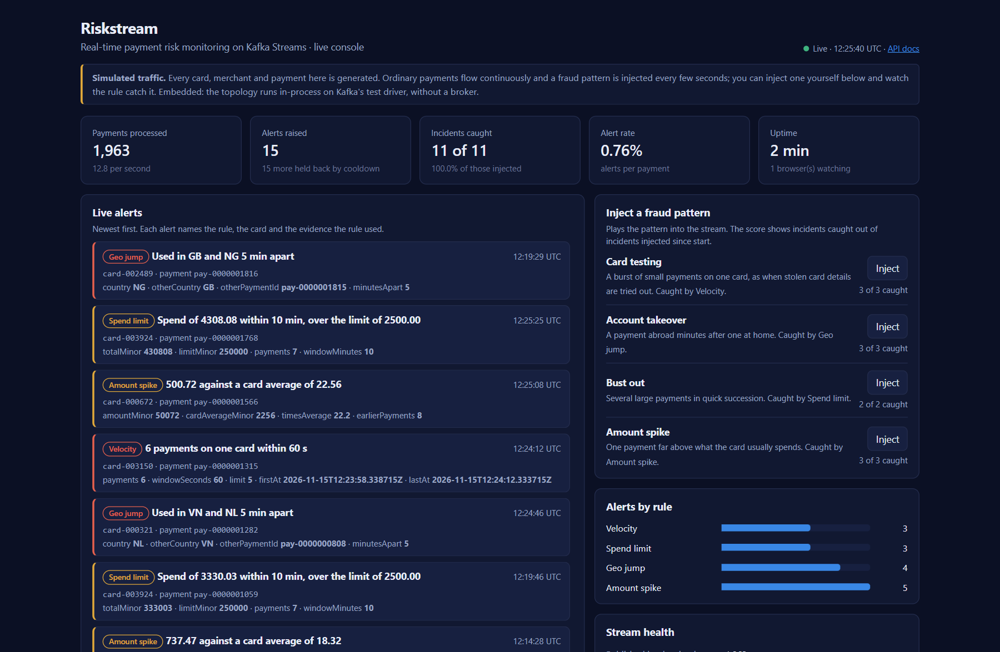

# Riskstream

**Real-time payment risk monitoring on Kafka Streams: stateful rules evaluated in event time, exactly-once processing, and a deterministic fraud simulator that scores the rules.**

Java 21 · Spring Boot 4 · Kafka Streams · event-time processing · exactly-once

> A portfolio project on simulated payments. The rules are simple, explainable thresholds, not a fraud model, and the service has no authentication.



---

## What it does

Payments arrive on a Kafka topic. Four rules judge each one against what is known about its card and raise alerts within about a second:

| Rule | Fires when |
|---|---|
| `VELOCITY` | More than 5 payments on a card within 60 seconds (card testing) |
| `SPEND_LIMIT` | More than 2,500.00 on a card within 10 minutes (bust-out) |
| `GEO_JUMP` | The same card used in two countries within 30 minutes (account takeover) |
| `AMOUNT_SPIKE` | A payment at least 8 times the card's own average |

The other four projects in this portfolio are batch or request/response. This is the streaming one: state held per card, decisions made as events arrive, and a processor that survives being killed.

## What makes it interesting

| Problem | How it is handled |
|---|---|
| **Events arrive late and out of order** | Rules run on the time on the payment, not the time of arrival. For a payment at T they look at every window of the rule's length *containing* T, on both sides, so a burst is caught whichever of its payments arrives last. |
| **A clock can lie** | A record with no payment cannot move stream time, and a payment cannot claim to be from the future (its time is capped at arrival plus 5 minutes). Both were real bugs found by tests: a junk record made genuine payments look late. |
| **Producers retry** | Each card remembers the payment ids it has seen; a repeat is dropped and counted, so a retried batch does not look like a burst. |
| **A processor crashes** | Kafka runtime uses `exactly_once_v2`: reading, updating state and writing the alert are one transaction. State is rebuilt from a changelog topic. |
| **One burst, many alerts** | A per-card, per-rule cooldown turns a burst of twelve payments into one alert. Suppressed firings are counted. |
| **State must stay bounded** | One compact record per card, pruned on every write, however long the card lives. |
| **Producer keys cannot be trusted** | Every payment is re-keyed by card through a repartition topic, so a card's state is always in one place. |
| **Are the rules any good?** | A simulator labels every payment with the scenario it belongs to; tests score each run: incidents caught, and alerts that fell on honest payments. |

Design, with the reasoning and the mistakes: [docs/design.md](docs/design.md).

## Measured

From `SimulationTest`: two simulated hours, 88,406 payments from 4,000 cards (12 a second), with 40 incidents of each of four fraud patterns mixed in. About 1 in 100 honest payments is a genuine large purchase, on purpose, so the false-alert figure is meaningful.

| Fraud pattern | Caught by | Incidents caught |
|---|---|---|
| Card testing | `VELOCITY` | 40 of 40 |
| Account takeover | `GEO_JUMP` | 40 of 40 |
| Bust-out | `SPEND_LIMIT` | 40 of 40 |
| One large payment | `AMOUNT_SPIKE` | 39 of 40 |

Alerts on honest payments: 378 of 87,648 (0.43%), almost all `AMOUNT_SPIKE` on genuine large purchases, which is the price of that rule at this threshold.

The same run with every payment delivered up to 20 seconds early or late catches the same incidents. These figures describe this simulator. Real fraud is rarer, more varied and adversarial, so they say nothing about real-world accuracy.

## Run it

### Without Kafka

Needs only JDK 21. The same topology runs in-process on Kafka's test driver.

```bash
./mvnw spring-boot:run          # Windows: mvnw.cmd spring-boot:run
```

Open http://localhost:8080. Traffic starts flowing, a fraud pattern is injected every 20 seconds, and you can inject one yourself and watch the alert arrive.

### Against a real broker

```bash
docker compose up --build       # Kafka + Riskstream in Kafka mode
```

Or point it at your own cluster: `RISKSTREAM_MODE=kafka KAFKA_BOOTSTRAP_SERVERS=host:9092`. Topics are created on start. Run several instances with the same `KAFKA_APPLICATION_ID` and Kafka shares the partitions between them.

### Host a public demo

[](https://render.com/deploy?repo=https://github.com/hasnaat93/riskstream)

The `Dockerfile` runs in embedded mode by default, sized for a 512 MB host; `render.yaml` describes it for Render. CI builds the image, starts it under a 512 MB limit and exercises it.

## API

| Method and path | Purpose |
|---|---|
| `GET /api/v1/stats` | Throughput, counters, alerts by rule, incidents injected and caught |
| `GET /api/v1/alerts?rule=&limit=` | Recent alerts, newest first |
| `GET /api/v1/alerts/stream` | Alerts as server-sent events |
| `GET /api/v1/rules` | The rules and their thresholds |
| `POST /api/v1/simulate/{scenario}` | Play one fraud pattern into the stream |
| `POST /api/v1/payments` | Publish one payment (202: published, judged asynchronously) |

OpenAPI at `/v3/api-docs`, Swagger UI at `/swagger-ui.html`. `cardId` is an opaque token and the API refuses unknown fields, so a card number sent by mistake is rejected rather than ignored. Writing endpoints share a small request budget, because the service has no sign-in.

## Tests

```bash
./mvnw verify       # 28 tests
```

| Suite | What it proves |
|---|---|
| `RiskTopologyTest` (20) | Every rule at its boundary, cooldown, duplicates, lateness, bad JSON, wrong producer keys, out-of-order delivery, the two clock guards. Driven record by record on Kafka's test driver, so each case is exact. |
| `SimulationTest` (3) | The scoring above, out-of-order delivery, and determinism. |
| `ApplicationIT` (5) | The whole application through HTTP: every scenario produces its alert and is counted, input validation, rules, health. |

CI also runs two jobs a laptop test cannot:

- **A real Kafka broker with a crash.** Riskstream is started as a Kafka Streams application, every fraud pattern is detected through the broker, the process is killed with `kill -9` and restarted, and then the alerts topic is read to its end with `read_committed`. The job asserts that no alert id appears twice.
- **The container image under a 512 MB limit.** It must boot, serve the console, detect an injected pattern and not be OOM-killed.

What was run, and what was not: [IMPLEMENTATION_STATUS.md](IMPLEMENTATION_STATUS.md).

## Limitations

- Four threshold rules on simulated data. Not a fraud model, and not tuned on anything real.
- Alerts live in memory (the latest 500) and a topic. Nothing stores them or manages cases.
- JSON on the topics, with no schema registry; invalid records are logged and skipped, not dead-lettered.
- The embedded runtime is single-threaded and keeps nothing across a restart. It shows the rules, not Kafka's scaling or fault tolerance.
- Tested on a single-broker Kafka. Multi-broker behaviour, rebalancing under load and long-running stability were not tested.
- No authentication. The demo is safe to expose only because its data is simulated and its writes are budgeted.

## Licence

[MIT](LICENSE)
