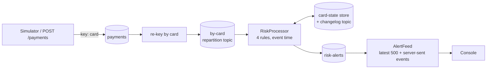

# Design

## Shape



One topology, built by a pure function (`RiskTopology.build`), with two ways to run it:

| | Kafka runtime | Embedded runtime |
|---|---|---|
| What runs the topology | `KafkaStreams` against a cluster | Kafka's `TopologyTestDriver`, in-process |
| Needs a broker | Yes | No |
| Guarantee | Exactly-once (`exactly_once_v2`) | None beyond the process |
| State survives a restart | Yes, rebuilt from the changelog topic | No |
| Parallelism | Partitions shared across threads and instances | One thread |
| Used for | Real deployment, the CI Kafka job | Local runs, a one-container demo, tests |

The embedded runtime exists so the project can be seen working without infrastructure. It runs the same processors and the same serialisation; what it cannot show is the part Kafka provides, which is why CI has a separate job against a real broker.

## Event time

Every rule is about time: "more than 5 payments in 60 seconds", "two countries within 30 minutes". The time that matters is when the payment happened, not when its record reached the processor. A consumer that falls behind and catches up receives a minute of traffic in a second; a retried batch arrives out of order. Judging by arrival time would raise false velocity alerts in the first case and miss real ones in the second.

So the topology takes each record's timestamp from the payment (`occurredAt`) and the rules only ever use that.

### Windows around the event, not before "now"

A stream processor's usual window is "the last minute up to the newest event". With out-of-order delivery that has a hole: if the sixth payment of a burst arrives before the fourth, then when the fourth arrives the "last minute up to it" holds four payments and nothing fires.

Here, for a payment at time T, the velocity and spend rules consider every window of the rule's length that contains T, looking on both sides. Whichever payment of a burst arrives last sees the whole burst. `SimulationTest` delivers every payment up to 20 seconds early or late and catches the same incidents.

### Lateness

State cannot be kept forever, so there has to be a point after which an old payment can no longer be judged: its neighbours have been let go. That point is `allowed-lateness` (30 minutes) behind the newest event seen. Older payments are dropped and counted (`late`), never silently lost.

A card's recent payments are kept for the allowed lateness plus the longest rule window, so that a payment arriving right at the limit still finds its neighbours.

### Two guards on the clock

Stream time only moves forwards, and lateness is measured against it. That makes the clock an attack surface, or at least an accident waiting to happen:

- **A record with no payment in it does not move time.** The first version let a junk record carry the broker's current time into the stream, which made the genuine, older-dated payments behind it look late. A test caught it.
- **A payment cannot claim to be from the future.** Its event time is capped at the time Kafka received it plus five minutes for clock skew. Without this, one payment dated ten years ahead would make every later payment late. From the cap onwards the capped time is the payment's time everywhere, including in its stored history.

## State

One record per card in a key-value store:

```
CardState(payments, totalMinor, recent[], seen{paymentId -> time}, lastFired{rule -> time})
```

Handling a payment is one read, the four rules over a short list, one write.

### Why not window stores

The first version used Kafka Streams window stores: one for a card's recent payments, one for seen payment ids. That is the idiomatic choice and the rule tests passed. Then the simulation test, at 87,000 payments, did not finish in ten minutes.

The in-memory window store is organised by timestamp first: a fetch for one key over a time range walks every timestamp in that range. Each payment was therefore paying for every other payment in the last hour, on every card. Cost grew with total traffic, not with the card's own activity.

Replacing them with one compact record per card made the cost per payment independent of total traffic. The whole simulation suite, which pushes five runs of about 88,000 payments through the full topology (JSON included), now finishes in about 70 seconds on a laptop. (A RocksDB window store is keyed by key then time and would not have this problem; the per-card record is still simpler and is one changelog topic instead of several.)

### Keeping it bounded

After each payment the card's record forgets what can no longer matter: payments older than lateness plus the longest window, seen ids older than the dedupe retention, cooldown marks that have expired. A card's record stays small however long the card lives. The lifetime count and total, used for the average, are two numbers.

### Partitioning

A card's state lives with the task that owns its partition, so all of a card's payments must reach the same partition. The topology does not trust the producer for that: it re-keys every payment by `cardId` and writes it through a repartition topic. That costs one extra topic and one extra hop, and removes a whole class of silent wrong answers.

## Delivery guarantees

**Duplicates in.** Producers retry, so the same payment can arrive twice. Each card remembers the payment ids it has seen for an hour; a repeat is dropped and counted. Without this a retried batch would look like a burst.

**Exactly-once through.** In the Kafka runtime, consuming a payment, updating the card's state and producing the alert are one transaction. After a crash the uncommitted work is discarded and redone, so the alerts topic contains each alert once. CI kills the process with `kill -9` mid-stream, restarts it, then reads the whole alerts topic with `read_committed` and asserts no alert id appears twice.

**Idempotent out.** An alert's id is derived from the payment id and the rule. A consumer that sees the same alert again, for whatever reason, can recognise it.

**Bad input.** A record that is not valid JSON is logged and skipped by the deserialisation handler; a valid record without the required fields is counted as malformed. Neither stops the stream.

## The rules

| Rule | Fires when | Severity |
|---|---|---|
| `VELOCITY` | More than 5 payments on a card within 60 s | High |
| `SPEND_LIMIT` | More than 2,500.00 on a card within 10 min | Medium |
| `GEO_JUMP` | A card used in two countries within 30 min | High |
| `AMOUNT_SPIKE` | A payment at least 8 times the card's lifetime average, once it has 5 earlier payments, and at least 100.00 | Medium |

All thresholds are configuration (`riskstream.rules.*`).

**Cooldown.** Once a rule fires for a card it stays quiet for that card for five minutes. A burst of twelve payments is one alert, not seven. Suppressed firings are counted.

**What these rules are not.** They are deliberately simple, explainable thresholds, each of which an analyst could read and argue with. They are not a fraud model. A real system would combine many more signals and would not treat every card alike.

## Measuring the rules

The simulator labels every payment it generates with the scenario it belongs to. The labels never travel on the stream. Tests use them to score a run: of the incidents injected, how many did the intended rule catch; and how many alerts fell on honest payments.

Honest traffic is not all small payments: about one in a hundred is a genuine large purchase, five to twelve times the card's usual. Those are there precisely so that the false-alert figure means something.

In the measured run, 378 of the 588 alerts (64%) fell on honest payments: `AMOUNT_SPIKE` 287, `GEO_JUMP` 74, `SPEND_LIMIT` 16, `VELOCITY` 1. The spike alerts are the rule doing what it was built to do on purchases the simulator deliberately made large. The `GEO_JUMP` ones were not investigated. As configured, these rules would produce far more false alerts than true ones, and threshold tuning (per-merchant, per-segment) would be the first job of a real deployment.

The figures are properties of this simulator, not predictions about real fraud. Real fraud is rarer, more varied and adversarial.

## What a production version would need

- Rules loaded from a compacted topic, so thresholds change without a deployment
- Alerts consumed into a database, with a case-management workflow
- Per-merchant and per-segment thresholds instead of one setting for every card
- Schema-managed serialisation (Avro or Protobuf with a schema registry) instead of JSON
- A dead-letter topic for records that cannot be read, rather than log-and-skip
- Authentication on the API, metrics and tracing, and lag alerts on the consumer group
- Standby replicas or RocksDB stores for faster recovery with large state
